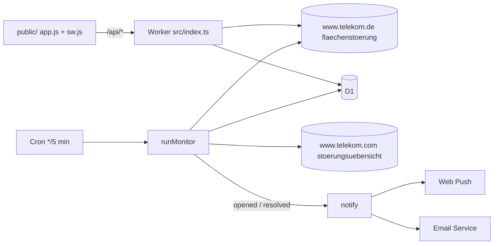

# Telekom Störungsmelder

Checks the [Telekom Flächenstörung](https://www.telekom.de/hilfe/hilfe-bei-stoerungen/flaechenstoerung) service for a landline number, records outage history for statistics, and notifies subscribers via Web Push (VAPID) or email. Telekom counterpart to [vodafone.jonas-strassel.de](https://vodafone.jonas-strassel.de) ([source](https://github.com/boredland/vodafone)).

Runs at <https://telekom.jonas-strassel.de> on Cloudflare Workers: static assets + Hono API, D1, Cron Triggers, Email Service, Rate Limiting.



## How it works

- **Upstream** (`src/telekom.ts`): the page is a server-rendered Spring Web Flow, not a JSON API.
  1. `GET /hilfe/hilfe-bei-stoerungen/flaechenstoerung` redirects twice through a silent-login check (`/tech/sam/ess/check` → `accounts.login.idm.telekom.com` → back) and lands on the form at `?execution…=e1s2`, with a `_csrf` token and a `VPJSESSIONID` cookie.
  2. `GET /tech/captcha` returns a 300×100 PNG bound to that session.
  3. `POST` the form (`credentials.connection.areaCode`, `credentials.connection.callNumber`, `captchaCode`, `_csrf`, `_eventId_submit=Submit`). The response redirects to the result page, or back to the form with a fresh captcha if the answer was wrong.

  Redirects are followed by hand so cookies set along the way are kept; one check is about 14 requests. The result is classified by `utag_data.page_content_id`: `…flaechenstoerung.fehler.keine-stoerung` means no outage, `…flaechenstoerung.l3light` means still on the form, and anything else is treated as an outage. The outage page has not been observed yet, so its ID and text are stored and shown verbatim. Telekom also answers "keine Störung" for numbers that aren't Telekom lines.
- **AWS WAF**: CloudFront challenges HTTP/2 clients like `curl` (`202`, `x-amzn-waf-action: challenge`). Node's and Workers' `fetch` pass without a token. The client throws a clear `UpstreamError` if the challenge appears.
- **Captcha** (`src/captcha.ts`): 4–6 Open Sans letters (`ABDEFGHJKMNQRTY`, `abdefghijkmnqrty`) in regular, bold and italic, with no noise. The solver is case-sensitive, as is the captcha. It decodes the PNG with `DecompressionStream`, cuts letters at blank columns, and matches each against glyph bitmaps taken from real captchas (cosine similarity over ±1 px shifts). Whether a glyph has a detached dot decides `i`/`j` versus the rest, which separates italic `j` from `J`. If the image doesn't split into 4–6 glyphs or any letter is ambiguous, the solver returns `undefined` and the client fetches a new image without submitting. Wrong answers are retried up to 3 times. Each check needs its own captcha. Solving takes about 25 ms of CPU.
- **Lines**: identified by a base64url SHA-256 of `<areaCode>/<number>`, so links, push tags and notification URLs don't contain the number.
- **Monitoring** (`src/monitor.ts`): every 5 minutes, the cron checks up to 60 lines (4 in parallel, oldest check first) that were viewed in the last 30 days or have a confirmed subscription. Opening a line also triggers a live check if the stored result is older than 2 minutes. Telekom gives no outage IDs, so an episode is keyed by the result page ID and text; a changed message ends one episode and starts the next. An outage must be absent for 9 minutes before it counts as resolved; its end time is when it first went missing.
- **Nationwide incidents** (`src/national.ts`): the same cron reads Telekom's [Störungsübersicht](https://www.telekom.com/de/newsroom/aktuelles/stoerungsuebersicht), a table with one row per service (MagentaTV, MagentaMobil, MagentaZuhause, Telekom Login, Telekom Mail, Kundenservice, Sicherheit), a status symbol and a text. It has only ever been seen all ✅, so any other symbol counts as a disruption and its text is shown verbatim. Each disruption is one episode in `national_incidents`; text changes update it in place, and it resolves when the service is ✅ again. A service missing from the table keeps its episode open. A page without the table fails the sync instead of reporting everything as fine. Active incidents are shown on every line's page; only MagentaZuhause (landline internet and telephony) alerts subscribers. Not included: `telekomstatus.statuspage.io` calls itself "die Statusseite der Deutschen Telekom", but no Telekom page links to it, so its provenance is unconfirmed.
- **Notifications** (`src/notify.ts`): sent when an outage opens or resolves, and when a nationwide MagentaZuhause disruption opens or resolves. Push subscriptions are active immediately. Email needs double opt-in. Emails carry RFC 8058 one-click `List-Unsubscribe`. Push endpoints that return 404/410 are deleted.
- **Web Push** (`src/webpush.ts`): VAPID JWT (ES256) and `aes128gcm` payload encryption on WebCrypto, shared with the Vodafone app.
- **Statistics** (`src/stats.ts`), each over 7/30/90/365 days: availability (overlaps merged), count, total and mean time to resolve, longest outage. Also minutes per day for the last 90 days, and start times by hour and weekday (Europe/Berlin). Windows are clamped to the period during which the line was actually observed.

## Captcha templates

`src/glyphs.ts` is generated from `captcha/train/<n>-<TEXT>.png`. `captcha/test/` is held out and must stay out of training.

```sh
npm run glyphs:build                       # regenerate src/glyphs.ts from captcha/train
npm run glyphs:eval                        # solve captcha/test: solved / skipped / wrong
node scripts/build-glyphs.ts label <dir>   # pre-label unlabelled captchas (<n>.png → <n>-<guess>.png)
```

749 training captchas (1,185 distinct glyphs); all 50 test captchas read correctly. If Telekom changes the font or layout, collect new images from `/tech/captcha` (works without a flow session), pre-label them, review the labels by eye, and rebuild.

## Privacy

No accounts, cookies or analytics. D1 stores the looked-up numbers (with no link to who looked them up) and their outage history. Subscribing adds the email address or the browser's push endpoint; unsubscribing deletes it, and unconfirmed email addresses are deleted after 7 days. The browser keeps the last line and its push tokens in `localStorage`. Rate limiting counts per client IP without persisting it. Cloudflare's Workers Logs (`observability` in `wrangler.jsonc`) keep request metadata for Cloudflare's retention period.

## Setup

Requires the Workers Paid plan (Email Service sending). `account_id` in `wrangler.jsonc` pins the Cloudflare account, since the login has access to several.

```sh
npm install
npx wrangler email sending enable telekom.jonas-strassel.de              # sending domain, creates its DNS records
npx wrangler d1 create telekom-stoerungen --binding DB --update-config   # writes database_id into wrangler.jsonc
npm run vapid                                                            # prints a VAPID key pair
npx wrangler secret put VAPID_PUBLIC_KEY
npx wrangler secret put VAPID_PRIVATE_KEY
npm run deploy                                                           # applies D1 migrations, then deploys
```

Do not change the VAPID keys once users have subscribed; existing push subscriptions are bound to the public key.

## Development

```sh
npm run vapid > .dev.vars
npm run db:migrate
npm run dev        # http://localhost:8787, emails are written to .wrangler/tmp/email
curl "http://localhost:8787/cdn-cgi/handler/scheduled?cron=*/5+*+*+*+*"   # run the monitor (needs `wrangler dev --test-scheduled`)
npm test
npm run typecheck
```

After changing `wrangler.jsonc`, run `npm run cf-typegen`. The sources only use erasable TypeScript (`erasableSyntaxOnly`), so `node` runs them directly, e.g. `node scripts/build-glyphs.ts eval`.

## License

[MIT](LICENSE)
